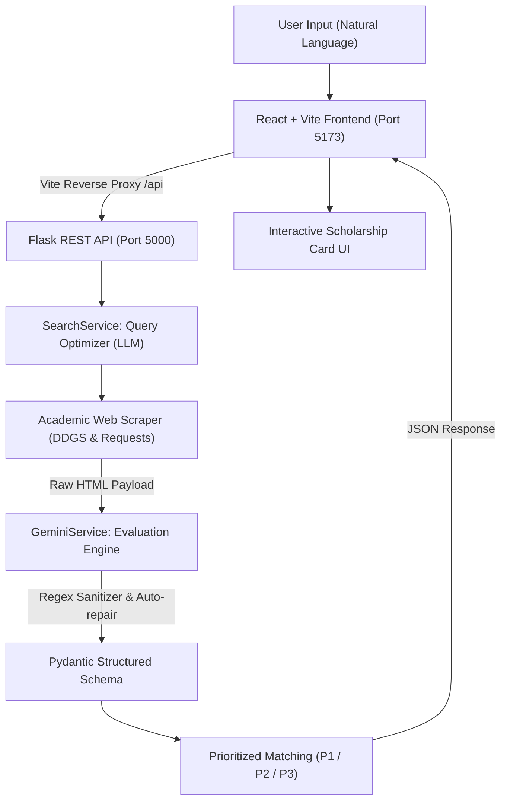

# 🎓 Smart Scholarship Miner & Evaluator

An enterprise-grade, AI-driven automation pipeline that mines, scrapes, evaluates, and ranks university scholarship opportunities tailored to candidate profiles. Built with a **Flask REST API**, **Google Gemini AI**, and a modern **React + Vite** frontend.

---

## 🌟 Key Architecture & Highlights

- **Intent-Aware Query Reformulation**: Transforms complex natural language user inputs into high-precision academic search queries using LLM pre-processing.
- **Resilient Web Scraping Engine**: Integrated with dynamic header rotation (`User-Agent`) and verified academic domain filtering (`.ac.uk`, `university`, `scholarships`).
- **Heuristic AI Evaluation (Gemini AI)**: Automatically extracts structured metrics, checks conversion eligibility (accepting non-CS / Commerce backgrounds), and categorizes into prioritized actionable tiers (`P1`, `P2`, `P3`).
- **Defensive Engineering & Fault Tolerance**:
  - Auto-repair mechanism for malformed JSON using **Regular Expressions (Regex)**.
  - Multi-tier model fallback (`gemini-flash-lite-latest` / `gemini-2.5-flash`).
  - Seamless reverse proxy via Vite for zero-CORS communication.
- **Enterprise Testing Suite**: Tested with **Pytest**, `@pytest.fixture`, parametrization, and unit tests.

---

## 🏗️ System Architecture Flowchart



---

## 📊 Evaluation & Priority Matrix (Heuristics)

| Priority | Criteria | Target Action |
| :---: | :--- | :--- |
| **P1 (High)** | Fully Funded (✅), No application fee, 66% (2:2 or Good) accepted, Low/Medium competition. | **Immediate Apply** |
| **P2 (Medium)** | Partial funding (⚠️), tight deadlines, or medium competition. | **Review & Prepare** |
| **P3 (Low)** | Expensive application fee, high Russell Group competition, or requires 1st class. | **Backup Option** |

---

## 🛠️ Tech Stack

### Backend
- **Language**: Python 3.14 / 3.11+
- **Framework**: Flask, Flask-CORS
- **AI Integration**: Google Gemini API (`google-genai`, REST `v1beta`)
- **Scraping & Search**: `duckduckgo_search` (`ddgs`), `requests`, `beautifulsoup4`
- **Validation**: Pydantic v2
- **Testing**: `pytest`, `unittest.mock`

### Frontend
- **Framework**: React 19, Vite
- **Styling**: Tailwind CSS
- **Icons**: Lucide React
- **Routing**: React Router DOM v7

---

## 🚀 Getting Started

### 1. Prerequisites
- Python 3.10+
- Node.js 18+
- Google Gemini API Key

### 2. Backend Setup
```bash
# Navigate to Backend folder
cd Backend

# Create and activate virtual environment
python -m venv .venv
# Windows:
.venv\Scripts\activate
# Linux/macOS:
source .venv/bin/activate

# Install dependencies
pip install -r requirements.txt  # or: pip install flask flask-cors requests pydantic python-dotenv duckduckgo_search pytest

# Configure Environment Variables in Backend/.env:
# GEMINI_API_KEY=your_api_key_here
# GEMINI_MODEL=gemini-flash-lite-latest

# Run the Flask Server
python app.py
```
*Backend runs on `http://127.0.0.1:5000`*

### 3. Frontend Setup
```bash
# Navigate to Frontend folder
cd ../Frontend

# Install dependencies
npm install

# Start development server
npm run dev
```
*Frontend runs on `http://localhost:5173`*

---

## 🧪 Running Unit Tests

The test suite covers schema validation, model fallback, and mock external API integrations:

```bash
cd Backend
python -m pytest tests/ -v
```

---

## 🛡️ License
Distributed under the MIT License. Developed for automated scholarship intelligence and conversion master programs.
